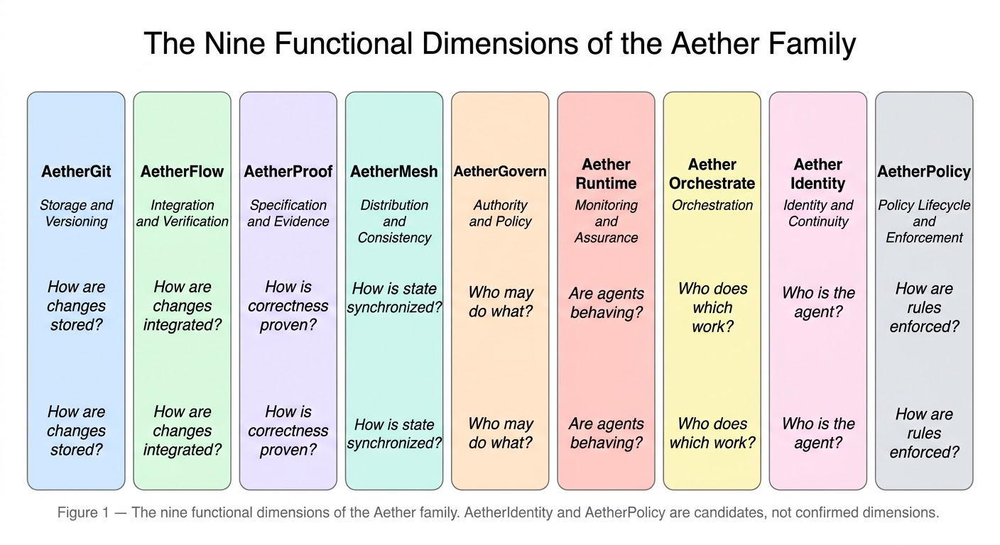
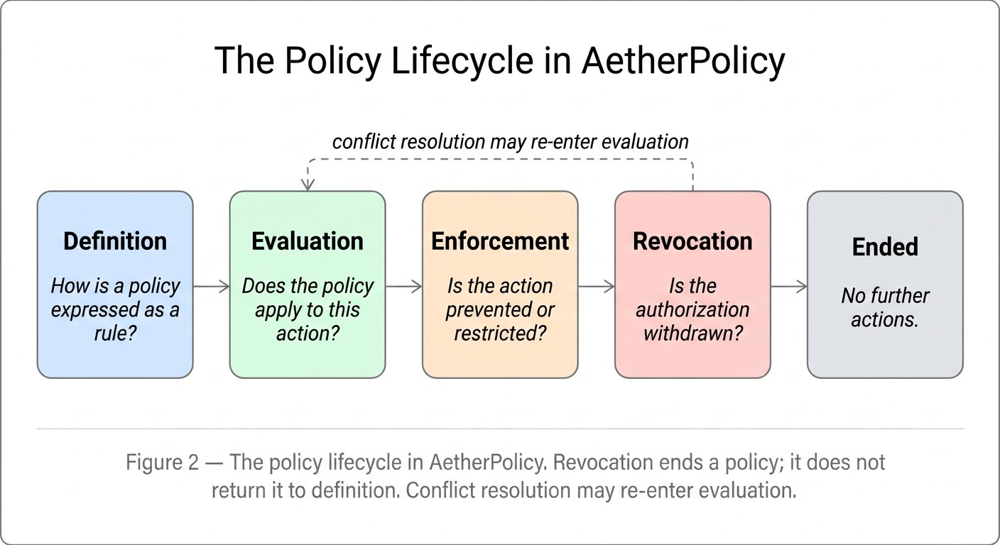
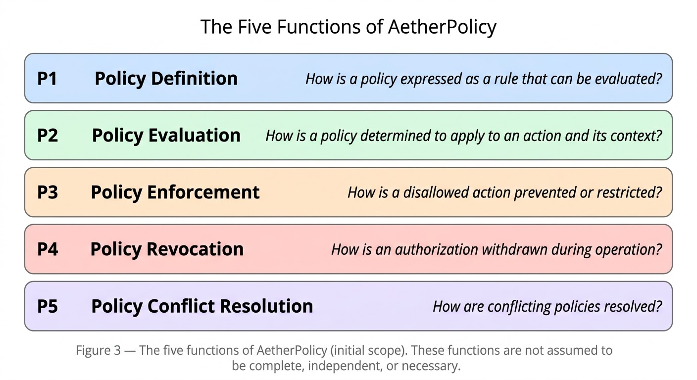
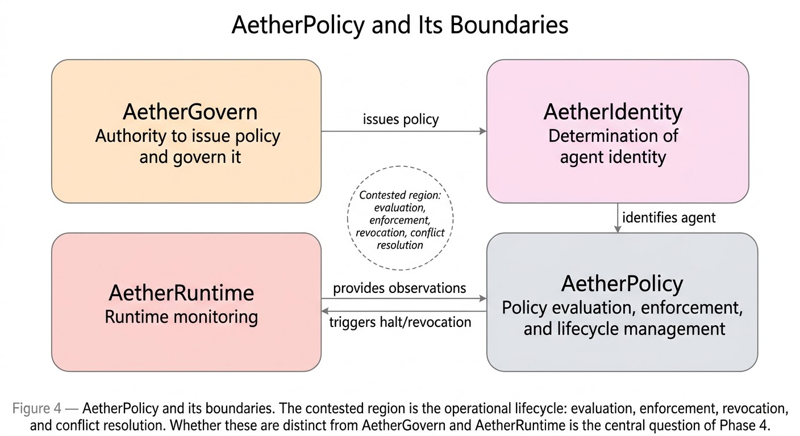
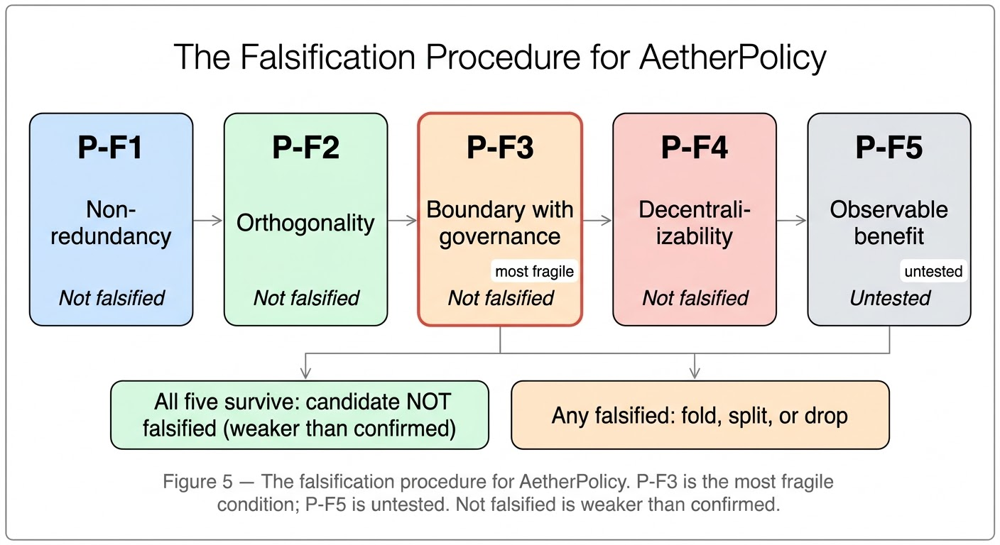
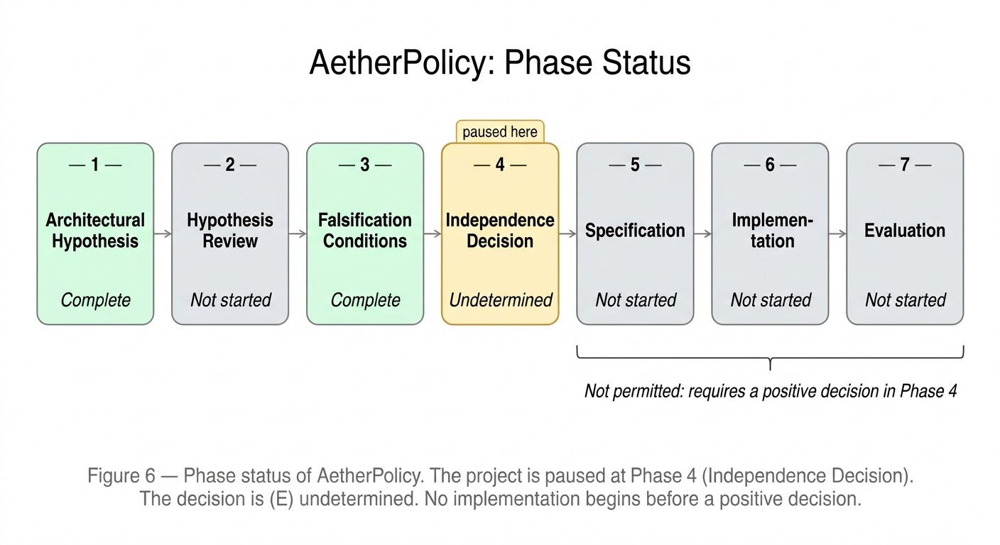

# AetherPolicy — Architectural Hypothesis

**Status:** Hypothesis under investigation. Not a committed project.
**Position in the Aether family:** Ninth project (candidate).
**Date:** 2026-11-11
**Author:** Samir Baladi
**ORCID:** [0009-0003-8903-0029](https://orcid.org/0009-0003-8903-0029)
**License:** CC-BY-4.0 (this document)

---

## 0. Status of this document

This document states a hypothesis. It does **not** state a result.

- It does **not** claim that AetherPolicy is an independent architectural dimension.
- It does **not** claim that the gap it describes is genuine.
- It does **not** claim that the boundaries with AetherGovern, AetherIdentity, and AetherRuntime are sufficient.
- It does **not** authorize implementation.

The next steps are: review of this hypothesis, review of the responsibility boundaries, definition of falsification conditions, and a decision on architectural independence. Only after that decision may specification or implementation begin.

---

## 1. Position in the Aether family

The Aether family currently has **eight projects**:

| # | Project | Status |
|---|---|---|
| 1 | AetherGit | Foundational |
| 2 | AetherFlow | Foundational |
| 3 | AetherProof | Foundational |
| 4 | AetherMesh | Foundational |
| 5 | AetherGovern | Foundational |
| 6 | AetherRuntime | Foundational |
| 7 | AetherOrchestrate | Foundational |
| 8 | AetherIdentity | Candidate (paper + v2.0.0 implementation; independence not settled) |
| 9 | **AetherPolicy** | **Candidate (this document; not yet studied)** |

AetherPolicy is the **ninth project**. It is **not** a replacement for AetherIdentity, and it does **not** renumber AetherIdentity. AetherIdentity remains the eighth project, with its independence still unresolved.

---

## 2. Central question

> **How can policies be transformed from declarative rules into evaluable, enforceable, and revocable operational constraints across decentralized autonomous agent systems?**

This is the initial central question. It is subject to revision after the hypothesis review.

---

## 3. Five functions (initial scope)

The following five functions are proposed as the **initial scope**. They are not final requirements. Each is subject to falsification.

| # | Function | Question |
|---|---|---|
| Fn1 | **Policy Definition** | How is a policy expressed as a rule that can be evaluated? |
| Fn2 | **Policy Evaluation** | How is a policy determined to apply to an action and its context? |
| Fn3 | **Policy Enforcement** | How is a disallowed action prevented or restricted? |
| Fn4 | **Policy Revocation** | How is an authorization withdrawn during operation? |
| Fn5 | **Policy Conflict Resolution** | How are conflicting policies between agents or environments resolved? |

These five are **not** assumed to be complete, independent, or necessary. A later phase may drop one, merge two, or add a sixth.

---

## 4. Architectural hypothesis

> **A potentially independent architectural gap may exist between governance authority and runtime monitoring: the operational management of policies as evaluable, enforceable, and revocable constraints across decentralized autonomous agents.**

This is a hypothesis. It is stated so that it can fail. Specifically:

- If **AetherGovern** already provides the operational management of policies (not just their issuance), the gap is not independent.
- If **AetherRuntime** already provides enforcement and revocation (not just monitoring), the gap is not independent.
- If the combination of AetherGovern and AetherRuntime, with a bounded extension, covers the five functions, the gap is not independent.

The hypothesis is falsified if any of the above holds.

---

## 5. Boundaries with the Aether family

The following four boundaries are the **initial points of contact**. They are not assumed to be sufficient.

| Dimension | Responsibility | AetherPolicy's relation |
|---|---|---|
| **AetherGovern** | Authority to issue policy, and governance of that authority | AetherPolicy consumes the authority; it does not issue it |
| **AetherIdentity** | Determination of agent identity | AetherPolicy evaluates against the identity of the acting agent |
| **AetherRuntime** | Runtime monitoring | AetherPolicy may use runtime observations as context; enforcement may trigger runtime actions |
| **AetherPolicy** | Policy evaluation, enforcement, and lifecycle management | This is the candidate's proposed responsibility |

**The boundaries are not assumed to be sufficient.** A later phase must analyze whether:

- AetherGovern's authority chains already cover policy evaluation and enforcement.
- AetherIdentity's status already determines policy applicability.
- AetherRuntime's monitoring already covers enforcement and revocation.
- The four boundaries overlap in ways that make AetherPolicy a feature, not a dimension.

---

## 6. Falsification-first methodology

AetherPolicy follows the same falsification-first methodology as AetherIdentity:

1. **Architectural Hypothesis** (this document).
2. **Hypothesis review** — independent review of the hypothesis and the boundaries.
3. **Falsification conditions** — specific conditions under which AetherPolicy does not deserve to be a separate dimension.
4. **Independence decision** — a decision on whether the candidate is independent.
5. **Specification** — only if the independence decision is positive.
6. **Implementation** — only after specification.
7. **Evaluation** — only after implementation.

**No implementation begins before step 4.**

The falsification conditions will be designed **for AetherPolicy**, not copied from AetherIdentity's F1–F5. They will address:

- Whether the five functions are already covered by AetherGovern, AetherRuntime, or a bounded extension of one of them.
- Whether policy evaluation and enforcement can be reduced to existing verification or governance mechanisms.
- Whether policy lifecycle management requires a central authority or strong consistency.
- Whether AetherPolicy yields an observable benefit over existing mechanisms.

These are **directions**, not final conditions. The final conditions are set in step 3.

---

## 7. What this document does not claim

- That AetherPolicy is an independent architectural dimension.
- That the five functions are complete.
- That the boundaries with AetherGovern, AetherIdentity, and AetherRuntime are sufficient.
- That the gap is genuine.
- That implementation should begin.

This document claims only that the hypothesis is worth investigating under the stated methodology.

---

## 8. Next steps

In order:

1. **Independent review** of this hypothesis and the four boundaries.
2. **Falsification conditions** designed for AetherPolicy.
3. **Independence decision**: is AetherPolicy a separate dimension, a feature of AetherGovern, a feature of AetherRuntime, or a bounded extension of one of them?
4. **If independent**: specification (`SPECIFICATION.md`).
5. **If not independent**: report the result, and do not proceed to implementation.

Stopping after step 3 is a legitimate outcome.

---

## Appendix A — Relationship to existing Aether projects

| Project | Relation to AetherPolicy |
|---|---|
| AetherGit | Storage of policy records (not policy semantics) |
| AetherFlow | Integration of policy-relevant changes (not policy evaluation) |
| AetherProof | Verification of policy artifacts (not policy enforcement) |
| AetherMesh | Distribution of policy records (not policy conflict resolution) |
| AetherGovern | Source of policy authority (not operational lifecycle) |
| AetherRuntime | Monitoring that may feed policy context (not enforcement itself) |
| AetherOrchestrate | Orchestration that may consume policy decisions (not policy evaluation) |
| AetherIdentity | Identity of the acting agent (not policy applicability) |

This appendix is a hypothesis about relations. It is not a result.

---

## Appendix B — Open questions (initial)

- Q1. Is policy evaluation a deterministic function of the admitted set, or does it require local context?
- Q2. Can policy conflicts be resolved without a central authority?
- Q3. Is policy revocation a runtime action, a governance action, or a separate lifecycle event?
- Q4. Does AetherPolicy require strong consistency, or can it operate over eventually consistent state?
- Q5. What is the minimal interface between AetherPolicy and AetherGovern?
- Q6. What is the minimal interface between AetherPolicy and AetherRuntime?
- Q7. Can policy evaluation be verified by AetherProof?
- Q8. Is AetherPolicy's observable benefit distinguishable from AetherGovern's?
- Q9. Does AetherIdentity's status already determine policy applicability?
- Q10. Can the five functions be reduced to fewer than five?

These are initial questions. They are not final.

---

## Appendix C — Figures

| # | Figure | Description |
|---|---|---|
| 1 |  | The nine functional dimensions of the Aether family |
| 2 |  | The policy lifecycle in AetherPolicy |
| 3 |  | The five functions of AetherPolicy (P1–P5) |
| 4 |  | AetherPolicy and its boundaries |
| 5 |  | The falsification procedure (P-F1 to P-F5) |
| 6 |  | Phase status |
